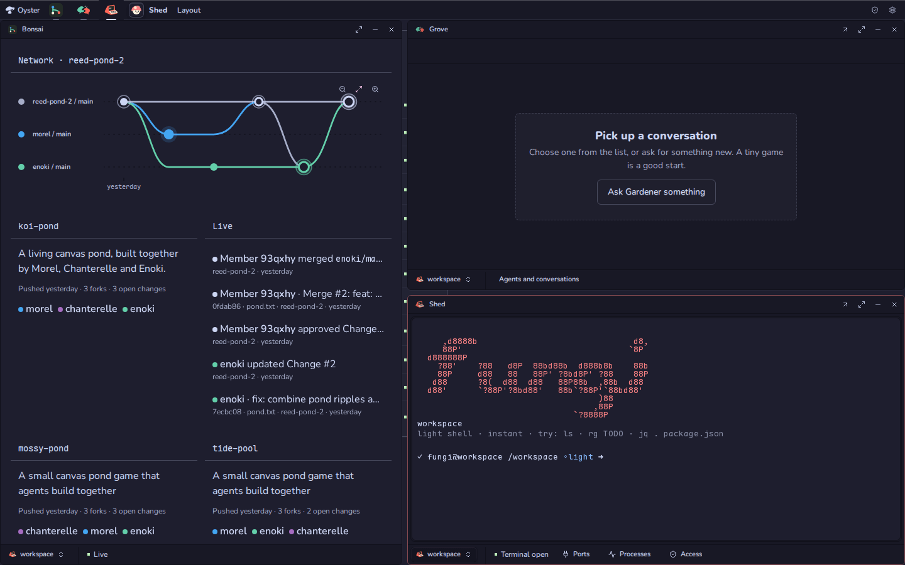
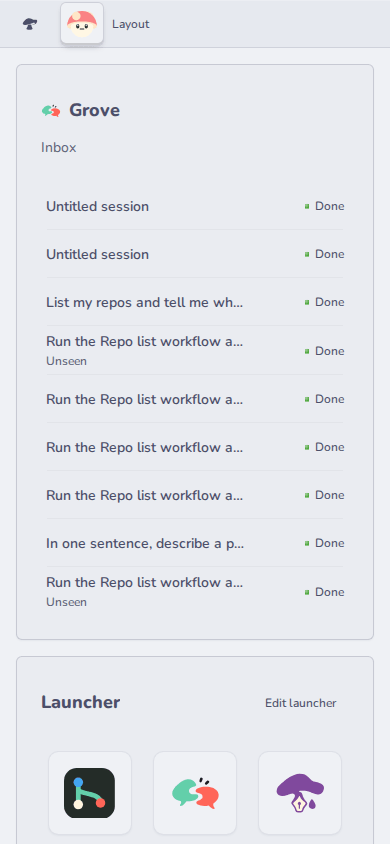

# Tourtois (`@fungi.computer/tourtois`)

Tourtois is the desktop for your Apps: a launcher, tiled or floating windows,
menus and settings.



Tourtois is the shell of [Oyster](https://github.com/fungi-computer/oyster), the
open App host that runs on your own Cloudflare account. When you sign in to an
Oyster, Tourtois is what you see, and every other App opens inside it.

## What you can do

- Launch Apps from the **Launcher** on the desktop or from the top bar.
- Arrange windows **Tiled** or **Floating** from the **Layout** menu: drag,
  resize, zoom one window, minimize it and bring it back. A minimized App keeps
  running, so restoring it never reloads it.
- Use the focused App's own menus in the top bar.
- Keep small live views of Apps on the desktop, such as Grove's inbox, and
  **Arrange desktop** to add, move, resize and remove them.
- Open **System Settings…** from the mushroom menu for App permissions, keys and
  agent connectors.
- On a phone, Apps open as a full-screen sheet over the desktop, and **Show
  desktop** brings it back without losing unsaved work.



Tourtois is a trusted shell. Every other App runs in its own sandboxed,
cross-origin frame, but Tourtois runs in the host's own page with your
permissions there. Pick a shell you trust: it can do anything you can on that
host.

## Get it

Tourtois installs with the other starter Apps, first of all. On a deployed
Oyster (see the
[Oyster quick start](https://github.com/fungi-computer/oyster#quick-start-deploy-your-own-oyster)),
run:

```sh
export OYSTER_URL=https://oyster.<your-subdomain>.workers.dev
export OYSTER_OWNER_KEY=<your owner key>
npx oyster install-apps
```

The installer clones this repository and the six others, seeds each on your
Oyster with `git push`, builds them on your Computer and installs them. Sign in
at `$OYSTER_URL/login` with the owner key and your Oyster opens on Tourtois. Run
`install-apps` again to update; each App keeps its data.

## Change it

Every installed App is also a template you can fork on your own Oyster,
including the desktop. Fork Tourtois into a Bonsai repository and clone it with
ordinary `git`:

```sh
curl -X POST -H "Authorization: Bearer $OYSTER_OWNER_KEY" -H 'content-type: application/json' \
  -d '{"appId":"app_tourtois","name":"my-tourtois"}' \
  $OYSTER_URL/apps/bonsai/methods/apps.fork
git -c http.extraHeader="Authorization: Bearer $OYSTER_OWNER_KEY" \
  clone $OYSTER_URL/git/bonsai/my-tourtois.git
```

The reply names your fork's App id and repository. Push your edits, open the
repository in Bonsai and choose **Settings**, then **Build & install** with that
App id and your commit as `git:<sha>`. Install the Release at `tourtois` to
replace the desktop. Building alone never changes what you see; only the install
does.

To work from GitHub instead, fork this repository and point the installer at
your forks with `--repositories <base URL>` and `--ref <branch or tag>`. The
installer reads all seven starter Apps from that base, so fork them under one
account.

## How a host mounts it

A Tourtois Release ships `shell.js` beside its `index.html`. The host imports
that module from its own origin and calls
`mountShell(root, { workbench, storage, methods })`, which renders the desktop
into the host's page with the host's workbench, Tourtois's own storage and its
methods. Tourtois's code loads as one lazy chunk behind that module, so no host
bundles it, and a fork mounts the same way.

Tourtois asks the host to mount each App in that App's own sandboxed frame,
under its own installation, Release and permissions. Settings pages are supplied
by the host too: Tourtois offers a page only when the host backs it.

## Agent tools

Agents can arrange your desktop. Through Oyster's MCP endpoint, or at
`POST $OYSTER_URL/apps/tourtois/methods/<name>` with a key (see
[Git, keys and MCP](https://github.com/fungi-computer/oyster#git-keys-and-mcp)),
they call:

| Method                                                             | What it does                                                    |
| ------------------------------------------------------------------ | --------------------------------------------------------------- |
| `layout.get` / `widgets.available`                                 | Reads the desktop and the live views Apps offer.                |
| `layout.place` / `layout.move` / `layout.resize` / `layout.remove` | Changes one item on the desktop.                                |
| `layout.launcher` / `layout.set` / `layout.reset`                  | Pins or hides launcher Apps, replaces the layout, or resets it. |

Each change names the revision it is based on, and a stale revision is refused
rather than overwriting a newer arrangement. In a connected browser, an agent's
change shows **Your Agent arranged the desktop** with **Undo** for ten seconds.

## Build and check

Tourtois is React and TypeScript. Windows and tiling come from
[Maosaico](https://github.com/fungi-computer/maosaico) and the controls from
[Caps](https://github.com/fungi-computer/caps).

```sh
pnpm install
pnpm build
pnpm typecheck
pnpm test
```

[src/AppWorkbench.tsx](src/AppWorkbench.tsx) composes the App list, windows and
layout. [src/shell-module.ts](src/shell-module.ts) is the `mountShell` entry,
[src/platform-controls.tsx](src/platform-controls.tsx) the Settings window, and
[src/settings-sections.ts](src/settings-sections.ts) the Settings pages a host
can supply. The agent tools are in [backend/methods.ts](backend/methods.ts), and
[package.json](package.json) declares what the shell asks of its host.

### Open windows and new versions

The directory refreshes every 15 seconds while the desktop is visible, as well
as on host change notifications. A changed active Release leaves the existing
App mounted and offers **New version available — Reload** in its existing window
footer. The footer already owns host status; the header remains the App's
navigation and window controls.

Reload uses Oyster's ordinary window replacement and asks the mounted App's
close veto before disposing it. Refusal leaves the old window and the Reload
offer intact. Acceptance mounts the active Release; closing and reopening also
uses the active Release without a notice. This does not transfer unsaved memory
or preserve obsolete backend authority. Permission changes and explicit
selection-changed recovery retain their existing reconciliation behavior.

With the Tourtois workbench running, `pnpm test:window-new-version` exercises
the directory change, footer action and reopen at desktop and phone widths.
`test/window-status-bar.test.tsx` proves the Reload close veto.

## License

MIT. See [LICENSE](LICENSE).

## This repository

This repository is generated from the App's directory in the Fungi monorepo
for each release. Its `@fungi.computer` dependencies are pinned to their
published versions and `pnpm-lock.yaml` resolves them from npm, so
`pnpm install --frozen-lockfile` and `pnpm build` work here, and
`oyster install-apps` builds it. The App's tests share fixtures with the
rest of the monorepo, so they run there and are not part of this repository.
